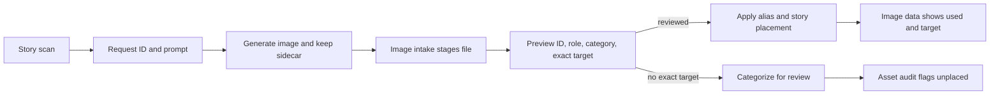

# Workbench image flow

## The three identities

- **Request ID (`story_key`)** identifies one dialogue beat that needs art. It
  is derived from the story file, label, and dialogue text; moving the line does
  not change it. Editing the target text creates a new request identity.
- **Asset ID (`asset_id`)** identifies the generated image bytes with a content
  hash. Renaming or recategorizing the file does not change this identity.
- **Ren'Py alias (`cg_*` / `bg_*`)** is the stable script name that points to an
  image path. Story scripts refer to this alias, not to generated filenames.

## How a file reaches story

1. The generator finds a story moment and emits its request ID, exact target,
   reference paths, prompt, and sidecar JSON.
2. Intake copies the image and same-stem sidecar to `game/images/` root. It does
   not alter story scripts.
3. Intake can assign a request ID, category, and role in the UI; it writes the
   same sidecar schema used by generated prompts, so routine imports need no
   manual JSON editing.
4. Preview calculates an asset ID, proposes a category, validates the request
   ID against the target fields, and confirms the exact dialogue exists once.
5. Apply moves the image and sidecar into its category, writes the image alias,
   and inserts the scene at the exact reviewed line. It records the final route
   and status in the sidecar.
6. Without a verified sidecar target, the image is organized as `needs_review`;
   filename words may suggest its category but never choose a story moment.

## How the app reads status

The Tauri backend scans Ren'Py aliases and scene/show statements for actual
story usage. It reads sidecars for request ID, asset ID, role, route, and
placement status. Overview, Image Data, and Asset Audit share this inventory;
they do not keep separate counts or reclassify the same file.

Use [IMAGE_IMPORT.md](../../developer-tools/IMAGE_IMPORT.md) for the operator
steps and sidecar example.
